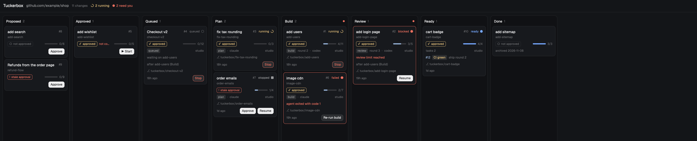
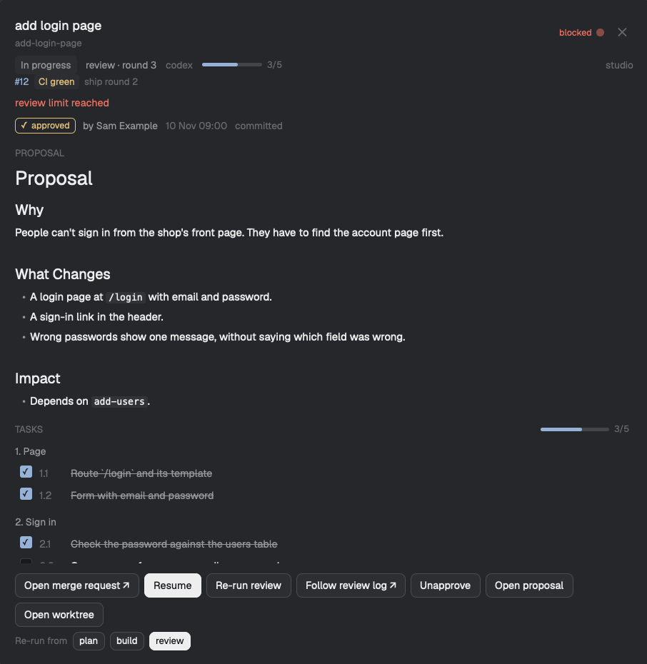

# Tuckerbox

Tuckerbox runs [OpenSpec](https://github.com/Fission-AI/OpenSpec) changes through coding agents: plan, build, review and ship, several changes at once, each in its own git worktree. Each repository decides how its own work runs, in a config file committed with it.

It's a single Go binary for macOS, Linux and Windows. It works on its own, and it fits into [Herdr](https://herdr.dev), where it shows a board of your changes and their agents.

> **Status:** early development. Local runs, the Herdr board and GitHub/GitLab shipping are available. The active plans and remaining integration work are in [`openspec/changes/`](openspec/changes/).

## Install

Tuckerbox needs Go 1.23 or later to build. There are no released binaries yet.

```sh
go install github.com/chrisjoyce911/tuckerbox/cmd/tuckerbox@latest
```

Or build from a checkout, with the version and commit stamped in:

```sh
CGO_ENABLED=0 go build \
  -ldflags "-X github.com/chrisjoyce911/tuckerbox/internal/version.Version=$(git describe --tags --always) \
            -X github.com/chrisjoyce911/tuckerbox/internal/version.Commit=$(git rev-parse --short HEAD)" \
  -o tuckerbox ./cmd/tuckerbox
```

The binary is built without cgo, so it is a single static file on macOS, Linux and Windows.

## Use

```sh
tuckerbox version   # version, commit, Go version and platform (--json for tools)
tuckerbox doctor    # checks git, openspec and the agent CLIs (claude, codex)
tuckerbox init      # writes a commented starter .tuckerbox/config.toml
tuckerbox herdr install  # installs or updates the board mod in the Herdr app
                         # (--keys: a key to open and hide it; --drawer: a peek drawer,
                         #  with Herdr running, else nothing changes; --topbar: a bar beside tabs
                         #  and a board in the Files/Changes side panel)
tuckerbox herdr uninstall  # undoes exactly what herdr install did
tuckerbox check     # validates it, merged with this machine's config
```

Run changes from inside the repository:

```sh
tuckerbox run fix-login            # one change, in the background
tuckerbox run --all                # every valid active change
tuckerbox run --foreground fix-login   # one change, attached to this terminal
tuckerbox run fix-login --tasks 2  # only task group 2 (or 2.3, 2.1-2.4, next)
tuckerbox status                   # every run on this machine (--json for dashboards)
tuckerbox board                    # this repository’s changes, approval and workflow columns
tuckerbox board --change fix-login --json  # board plus proposal, tasks, rounds and history
tuckerbox board --json --repo github.com/you/shop  # this machine's checkout of that repository, from anywhere
tuckerbox logs fix-login --follow  # watch the running step's agent
tuckerbox stop fix-login           # stop the agent; the run is marked stopped
tuckerbox resume fix-login         # continue a stopped or blocked run
tuckerbox answer fix-login "Keep the rollback."  # answer a blocked run's question (--resume: and resume it)
tuckerbox rerun fix-login review   # start again from a step
tuckerbox history fix-login        # every event of the run, oldest first (--json for tools)
```

Fix a change's OpenSpec files through Tuckerbox, so no run starts meanwhile:

```sh
tuckerbox edit fix-login design      # proposal, design, model, tasks or spec:<capability>
tuckerbox tasks fix-login tick 2.1   # or untick; changes only that checkbox
tuckerbox validate fix-login         # openspec validate --strict (--json for tools)
```

They work in the change's worktree if it has one on this machine, else in the checkout, and refuse while its run is queued or running. They never commit. The editor is `editor` in machine config, else `$VISUAL`, else `$EDITOR`; a GUI editor must wait for the file to close (`code --wait`). `edit` validates strictly when the editor exits.

A change must be approved before `tuckerbox run` starts it:

```sh
tuckerbox approve fix-login     # validates strictly, then publishes the approval
tuckerbox run fix-login         # on this machine or any other, straight away
tuckerbox unapprove fix-login   # withdraw it, also published at once
```

`approve` records a hash of the proposal, design, model, tasks and spec deltas, your git `user.name` and the time as `approvals/<change>.toml` in a commit on `refs/tuckerbox/approvals`, and pushes it to `origin` at once (with `--force-with-lease`, retrying if someone else approved at the same moment). There is nothing to commit: the approval counts on every machine as soon as it is pushed. The ref isn't a branch, so CI doesn't run on it. Offline, the approval counts on this machine, the board marks it `not published`, and the next approve, unapprove or board read publishes it; `tuckerbox doctor` says whether the ref can be pushed. An approval written by an older Tuckerbox as `[approval]` in the change's `tuckerbox.toml` still counts when the ref has nothing for that change. The run judges the hash against the files it will start from: the change's worktree if it has one, else its branch or the base branch after a fetch. Ticking tasks keeps the approval; any other edit to those files makes it stale on every machine, and the change needs approving again. `tuckerbox run --all` skips changes that aren't approved and lists them. The approval also records `settings_hash`, a hash of the change's own `agent` and `permissions` step overrides (see Change settings below): changing either makes the approval stale too, and the refusal names the override. Changing a `model`, `effort` or `machines` keeps the approval, and an approval with no `settings_hash` (from an older Tuckerbox) counts as approving no overrides. Resume and re-run don't check the text again, since a step may rewrite the design, but with approval required they refuse when an `agent` or `permissions` override changed since approval, naming it; approve the change again or set the override back. To turn the gate off for a repository, set it in the repository config (machine config may not):

```toml
require_approval = false
```

Each change gets its own worktree (by default `../<repo>-worktrees/<change>`) and branch, made from the remote's default branch after a fetch. Existing worktrees are reused as they are: Tuckerbox never resets, cleans or stashes them. At most `max_parallel` changes run at once; the rest are `queued` and start in admission order (see Priority below), which without priorities is the order requested. With `ship = "local"`, a run that finishes commits what is left on its branch and becomes `ready`; nothing is pushed. A change must pass `openspec validate` and be committed on the base branch.

A run can take part of a change: `--tasks 2` runs task group 2, `--tasks 2.3` one task, `--tasks 2.1-2.4` a range in tasks.md order, and `--tasks next` the first group with an unticked task. The brief tells every step to work on, tick and judge only those tasks, and the run is `ready` only when they are all ticked (else `blocked`, naming them). The scope belongs to the change's one run, in the same worktree and branch: `resume` and `rerun` keep it, and `run --tasks` with another scope on a ready, stopped, blocked or failed run starts it again from the first step (`run` without `--tasks` means the whole change). Approval covers the whole change, not the scope: each new scope passes the run gate again, so ticking tasks keeps it approved but any other edit to the change during a scope must be approved before the next. A task whose text starts with `(ship)`, such as archiving the change, is done by shipping: it is never in a scope and doesn't count toward the change being complete. A task only CI can do starts with `(ci)`, such as `- [ ] 6.2 (ci) Go tests pass on Linux, macOS and Windows CI`; text that says it passes (or is green) on or in CI counts without the marker. With `ship = "mr"` or `"merge"` a CI task doesn't hold a scope or the change back: shipping ticks it, in a commit `Tick <change> task 6.2` pushed to the merge request, once CI is green there (and waits for CI on that commit before merging). In local mode it counts like any other task, and the step brief doesn't tell builders to leave it unticked. If a step archives the change on its branch, the run reads the archived tasks.md, counts the change as complete, and shipping doesn't archive it again.

To keep approved changes moving without starting each run by hand, run autopilot in a terminal or a Herdr pane:

```sh
tuckerbox autopilot            # until Ctrl-C; --once for one pass, --dry-run to see what it would start
```

It is not a service: it runs in the foreground for the repository it is started in, one per repository on a machine, and the runs it starts keep going when you stop it. On each pass (every `[autopilot] interval`, 60 s by default, and whenever a run ends) it fetches the base branch and starts approved changes whose dependencies are met while `max_parallel` has room, group by group with `--tasks next` (`[autopilot] scope = "change"` runs whole changes). Approval is the one gate it keeps: it refuses to run with `require_approval = false`, never approves, edits or ticks, and never resumes a blocked or stopped run or re-runs a failed one. A run whose process died is resumed once per crash streak (counted from history since the run's last step result or a person's action). Every start or resume carries the state and time it saw, and the engine does nothing if the run moved on meanwhile. Runs that need you are printed once, flagged on the board (`needs_you`), and toasted by the Herdr board mod; the board header shows whether autopilot is on.

A change can wait for others: list them in `openspec/changes/<change>/tuckerbox.toml` as `depends_on = ["add-users"]`. Its run stays `queued (waiting on add-users (build))`, without taking a slot, until each dependency is `ready` on this machine or archived. A dependency run with a task scope counts only once a run of it is ready with the whole change ticked: `queued (waiting on add-users (ready, tasks 1))`. `tuckerbox check` reports dependencies that name no active or archived change, and cycles.

### Priority

You decide which change goes next by ranking them:

```sh
tuckerbox priority                 # the active changes in priority order (--json for tools)
tuckerbox priority add-login top   # move a change to position 1
tuckerbox priority add-login 3     # to position 3 (past the end means last)
tuckerbox priority add-login up    # one place up (or down)
```

The rank is `priority = <n>` in `openspec/changes/<change>/tuckerbox.toml`: lower first, and a change without one comes after every ranked change. People use positions; Tuckerbox picks the numbers, with gaps of 1000, so a move usually rewrites one line of one file, and renumbers the ranked changes only when no gap is left. `tuckerbox check` reports a `priority` that isn't a positive integer. On the board, drag a card within its column to reorder it.

`priority` writes the repository checkout on this machine, never a change's worktree, even while the change is queued or running, and never commits. Queued runs on this machine follow the new order at once; commit and push the files for other machines to see it. `tuckerbox.toml` isn't part of the approval hash, so a priority never makes an approval stale. `priority`, `approve`, `unapprove` and `set` take a short repository-wide lock around each rewrite, so they never lose each other's edits.

When a slot frees, the queued run first in admission order takes it: lowest priority first, where a change counts as urgent as the most urgent active change that depends on it, then the one requested first. Age doesn't count, so with no priorities the order is the order requested. `tuckerbox run --all` requests changes oldest first and starts them in that order. A higher priority never stops a running change; it only decides who takes the next free slot. Edits to `priority` made outside Tuckerbox (an editor, `git pull`) count from the next admission.

Run state is kept in the worktree's git directory (`$(git rev-parse --git-dir)/tuckerbox/`), never in the tree. Next to the current state (`run.json`), each run appends its events (started, steps, hand-offs, rejections with findings, stopped, resumed, ready) to `history.jsonl` there; the format is documented in [`internal/history`](internal/history/history.go). `status` finds runs through a machine index in `$XDG_STATE_HOME/tuckerbox/`, `~/.local/state/tuckerbox/` on macOS and Linux, or `%LocalAppData%\tuckerbox\` on Windows.

A repository's workflow lives in `.tuckerbox/config.toml`, committed with it. Machine defaults go in `$XDG_CONFIG_HOME/tuckerbox/config.toml` if that variable is set, otherwise `~/.config/tuckerbox/config.toml` on macOS and Linux and `%AppData%\tuckerbox\config.toml` on Windows. Repository values win, except that permission profiles (the flags that let agents run without prompts, and which repository remotes may use them) the editor and the agent backend can only be set on the machine:

```toml
# machine config
[permissions.edit]
allowed_remotes = ["github.com/you/*"]
args = { claude = ["--permission-mode", "acceptEdits"] }
```

A step in the repository then asks for it by name with `permissions = "edit"`.

A change can pick its own agent, model, effort and permission profile per step, in `openspec/changes/<change>/tuckerbox.toml`, within limits the repository sets. The step tables use the same names as repository config, and may hold only those four keys. `machines` lists the machines the change prefers, in order; it has no effect in solo mode:

```toml
# openspec/changes/add-login/tuckerbox.toml
machines = ["studio", "mini"]

[steps.build]
agent = "codex"
model = "gpt-5.5"
effort = "high"

[steps.review]
permissions = "readonly"
```

The repository decides what a change may pick with `[overrides]` in `.tuckerbox/config.toml` (machine config may not set it, so every machine allows the same). Nothing is allowed by default: with no `[overrides]`, or a key missing from it, a change may not override that key. Models are listed per agent, because a model name only means something to one CLI. `permissions` lists profile names only: the machine's `[permissions.<name>]` still decides the flags and which remotes may use it, so a change can't grant itself anything.

```toml
[overrides]
agents = ["claude", "codex"]
models = { claude = ["opus", "sonnet"], codex = ["gpt-5.5"] }
efforts = ["medium", "high"]
permissions = ["edit", "readonly"]
```

`tuckerbox check` reports, for each active change, a step the repository doesn't define in `[steps]`, a key other than the four (agent arguments and flags belong in a machine profile), a value the allow-list doesn't hold (with the allowed values; a model is judged against the step's agent after the change's own `agent`), and a profile this machine doesn't define or grant for the step's agent.

Each step runs with, per key, the change's value, else the repository step's, else the machine step's, else the agent's default. When a change picks another agent for a step, a model or effort the config set for the old agent is dropped: the new agent gets the change's value or its own default. `run`, `resume` and `rerun` check the overrides again against the `[overrides]` allow-list, reading both the change's settings and `.tuckerbox/config.toml` from the files the run starts from (the worktree, else the commit a new worktree is made at), not the checkout you run from, and refuse before making a worktree or changing the run, so narrowing `[overrides]` stops changes that relied on it. A run reads the change's settings and the allow-list in its worktree as each step starts, and records what the step started with, and where each value came from (`change`, `repo`, `machine` or `default`), in `run.json` and the step's `step_started` history event; a profile is recorded by name, never its flags.

`tuckerbox set` changes one of these settings without opening the file:

```sh
tuckerbox set add-login step.build.agent=codex
tuckerbox set add-login step.review.effort=high
tuckerbox set add-login machines=studio,mini      # comma-separated, in order
tuckerbox set add-login --unset step.build.model  # back to the repository's value
tuckerbox set add-login --json step.build.model=gpt-5.5   # result as JSON, for the board
```

Keys are `step.<step>.agent`, `step.<step>.model`, `step.<step>.effort`, `step.<step>.permissions` and `machines`. A step value is checked against `[overrides]` first, in the `.tuckerbox/config.toml` next to the sidecar it writes, and refused with the allowed values; a profile this machine doesn't grant is only a warning, because the change may run elsewhere. `--unset` removes one key, and a `[steps.<step>]` table left empty; removing a key that isn't set changes nothing. `set` rewrites only that key's line, keeping comments and every other key and table (`depends_on`, `priority`, `[approval]`), and refuses a file laid out in a way it can't rewrite line by line (such as dotted keys) rather than mangle it.

Like `tasks`, `set` writes where edits happen: the change's worktree if it has one on this machine, else the repository checkout. It holds the change's run lock while it writes, so it refuses while a run of the change is queued or running, and says which step is running; a stopped or blocked run picks the new value up from the next step it starts. Setting an `agent` or `permissions` override makes an approval stale, so with approval required `run`, `resume` and `rerun` refuse until the change is approved again; `model`, `effort` and `machines` keep it. It never commits: the value counts on other machines, and for a run that makes a new worktree, only once the sidecar is committed and pushed.

The board defaults to Proposed, Approved (when approval is required), In progress,
Ready and Done. In-progress cards carry their step or `queued` as a badge.
To show Queued and one column per workflow step, set this in repository config
(or machine config as a default; repository values win):

```toml
[board]
columns = "steps" # "compact" is the default
```

In Herdr, the board looks like this with `columns = "steps"` (from the mod's
fixtures, an example shop repository):



With `tuckerbox herdr install --topbar`, the bar shows Tuckerbox, running and
needs-you counts, and a menu for Board, Board in side panel, and Settings.
In a git repository without a Tuckerbox config it offers **Set up Tuckerbox**,
which opens a pane running `tuckerbox init`. Outside repositories it takes no
space. Herdr must be running for `--topbar` or `--drawer`; asking for both
shares a single clone of a shipped layout. `tuckerbox herdr uninstall` restores
unchanged layouts byte for byte and removes only recorded blocks from layouts
you edited afterward.

Clicking a card opens its detail: proposal, tasks with tick boxes, approval,
rounds, history and the actions its state allows.



Settings, in the board header, shows the repository's and this machine's configuration in place of the columns: each value with where it comes from (`repo`, `machine` or `default`), grouped as Workflow, Runs, Board, Autopilot and Change overrides, and, under "This machine only", Permission profiles, Forge tokens, Editor and Machines. Edits collect as pending, are checked with `tuckerbox config set --dry-run` as you make them, and are saved together by one `tuckerbox config set --if-match`; the view says before Save whether it goes to a pull request or the checkout, and why. A forge token is entered only at the prompt Set token opens in a pane. The view writes no file itself (see `herdr/mods/tuckerbox-board/README.md`, Settings).

Agents report by ending with a small JSON result as their final message; Tuckerbox records it in the step's result file, so an agent needs no write access outside its worktree and a reviewer can run read-only (for Codex, `--sandbox read-only` in a machine profile). Tuckerbox reads Claude's final message from its stream-json output and Codex's from the file it writes with `-o`. A custom agent can pass `{lastmessage}`, a file its CLI writes the final message to; otherwise its standard output is read:

```toml
[agents.myagent]
command = ["myagent", "--prompt-file", "{brief_file}", "--last-message", "{lastmessage}"]
```

`{brief}` is the brief's text and `{brief_file}` the brief file's path; a custom agent passes one of them. Headless agents get the brief in their command, so they need no read outside their worktree. An agent in a terminal (see Terminals below) reads the brief file, which is in the run state outside the worktree: Tuckerbox gives a terminal Claude read access to the brief's folder with `--add-dir=<folder>` (unless its permission profile already adds it), and Codex may read any file in every sandbox mode, so it needs nothing. A custom agent in a terminal must be able to read `{brief_file}`'s folder. When the command would be longer than 24,000 characters as a Windows command line (on every platform), Claude and Codex read the brief on standard input instead, and a custom agent's `{brief}` becomes an instruction to read the brief file. Logs and run state show the brief as `<brief: N chars, <file>>`.

Where step agents run is a fact about the machine, so `agent_backend` is set only in machine config (`tuckerbox check` refuses it in a repository):

```toml
# machine config
agent_backend = "auto" # the default; or "terminal" or "headless"
```

`auto` uses herdr-core terminals when `hc` is on the PATH and `hc server status` succeeds, and otherwise runs agents headless, as child processes of Tuckerbox with their output in the step's log. `headless` always does that. `terminal` requires herdr-core: when it isn't installed or its server isn't running, `tuckerbox run` refuses and starts nothing. `tuckerbox doctor` reports the backend in use and why, for example `agent backend: headless, because herdr-core wasn't found (no hc on the PATH)`.

In a terminal, Claude and Codex run in their interactive mode, with "read the brief" as the first prompt, so a person can watch the agent and type to it. Each step's terminal is named for the change (`tb-` and a hash), labelled `herdr.space` (the repository) and `herdr.tab` (`<change> · <step>`), so the Herdr app shows it as a tab. At the end of every turn the CLI's own hook (Claude Code's `Stop` hook, passed with `--settings`; Codex's `notify`, passed with `-c`) hands the turn's final message to Tuckerbox; no user or project config file is changed. A turn that ends without a result leaves the step running, waiting for you. Claude Code asks whether to trust a folder it hasn't seen, and a change's new worktree is one: when a terminal Claude's screen shows that prompt for the step's worktree in its first two minutes, Tuckerbox answers "Yes, I trust this folder" (and says so in the step log). A prompt for any other folder is left to you. A custom agent runs in a terminal only when it has an `interactive` command with `{turnhook}`, the hook to run at the end of each turn (as a whole argument, its program and arguments; inside an argument, one shell command; it takes the message as its last argument or on standard input):

```toml
[agents.myagent]
command = ["myagent", "--prompt-file", "{brief_file}"]
interactive = ["myagent", "--on-turn-end", "{turnhook}", "{brief}"]
```

The agent outlives Tuckerbox's run process. If that process dies, `tuckerbox status` shows the run `running (not watched)`; `tuckerbox resume` (or autopilot's crash resume) adopts the live agent in the same round, and `tuckerbox stop` ends it. A `run` or `rerun` that starts a new round ends that agent first. A run is recorded `stopped` only once its agent's terminal has ended; if herdr-core can't end it, the run stays `running (not watched)` and `stop` can be tried again. The agent keeps its parallel slot while it lives, so no other change starts in its place. `tuckerbox logs` reads a live agent's terminal, and the step's log keeps its session afterwards. `doctor` checks the turn-hook format Tuckerbox expects and the flag each installed CLI takes it with; whether a CLI version really runs the hook is only seen in a real turn, and doctor says so.

### Answering a run

A step that reports `blocked` asks the person something: its summary and findings are the run's question, shown by `tuckerbox status` (under the table, and as `question` in `--json`) and on the board card with the step and round that asked. Answer it with:

```sh
tuckerbox answer fix-login "Herdr check done by hand: keep the rollback."
tuckerbox answer fix-login --file decision.md   # or - to read standard input
tuckerbox answer fix-login --resume "use plan B" # record, then resume as tuckerbox resume does
```

`answer` takes the change lock, adds the answer (its text, your git `user.name`, the time, and the step and round it answers) to `answers` in the run's state, writes an `answered` history event, and leaves the run blocked. An answer is at most 16 KiB. It refuses a run that isn't blocked and records nothing, unless the run's step runs in a terminal whose agent waits for you: then the text is typed into that terminal (`hc send` to its address, only while it is still that step and round's terminal), as typing in its tab would, and recorded in history, and the run keeps running. When the run resumes, the step's brief has a section "Answers from a person" with the question and every answer since, oldest first; they stay in that step's briefs (after a crash or a stop too) until it reports a result, and later briefs leave them out. `--resume` keeps every gate and refusal of `resume`: if the resume is refused, the answer stays recorded, the output says so, and a later `resume` uses it. On the board, a blocked card's detail (or a card whose agent waits) shows the question, the answers so far and a text box: Answer runs `tuckerbox answer <change> -` with the text on standard input (piped in by `sh`, or by PowerShell when the card's machine runs Windows), and on a blocked card Answer and resume adds `--resume`.

`doctor` exits non-zero only when a required tool (`git` or `openspec`) is missing. Agent CLIs are optional. It does not yet check whether an agent is signed in, and says `sign-in not checked`.

## Forge configuration

The repository chooses the shipping mode:
`local` commits locally, `mr` stops at a green merge request for a person to
merge, and `merge` merges the exact green head when forge protection allows.

```toml
# Repository .tuckerbox/config.toml
ship = "mr"

[workflow]
steps = ["build", "review"]
[steps.build]
agent = "claude"
role = "builder"
[steps.review]
agent = "codex"
role = "reviewer"

[shipping]
remote = "origin"
fix_ci = "fix_ci"
fix_review = "fix_ci"
max_rounds = 3
merge_method = "merge"  # merge, squash or rebase; GitLab uses project strategy
archive = true
labels = []
review_from = []
wait_timeout = "2h"

[steps.fix_ci]
agent = "claude"
role = "fixer"

# For self-hosted forges, name the kind (github or gitlab):
# [forge]
# kind = "gitlab"
# api_url = "https://git.example.org/api/v4"
```

API URLs must use HTTPS on the push remote's host. SSH aliases resolve through
local `ssh -G` configuration. GitHub.com and GitLab.com are detected automatically;
other hosts require a kind in repository `[forge]` or machine `[forges]` config.
Authenticated API requests refuse redirects. GitHub's signed log downloads use
separate HTTPS requests without credentials or cookies.

```toml
# Machine config only; never commit tokens or token sources to a repository.
machine = "studio"
[forges."git.example.org"]
kind = "gitlab"
token_env = "WORK_GITLAB_TOKEN"
borrow_cli_token = false
```

Tokens come first from the named variable, then the machine's credentials
file (below), then `GH_TOKEN` / `GITHUB_TOKEN`
on github.com or `GITLAB_TOKEN` on gitlab.com only. Setting `borrow_cli_token = true`
allows the host-specific stored token from `gh` or `glab` to be read with a
five-second timeout. Borrowing is off by default; no login or refresh is run.
Tokens are masked in forge text and are never added to agent environments.
Git pushes retain git's own credentials. `tuckerbox doctor` reports the forge,
project, token source and API read/push permissions in `mr` and `merge` repositories.
A completed shipping run archives the change in its branch before pushing. It
uses explicit leases for every push and pins every merge to the green head.
Failed CI jobs and unresolved review threads from writers or named bots go to
the configured fix steps, with bounded rounds. Logs are masked, stripped of
colour codes and limited to the last 200 lines, 32 KiB per job and 128 KiB per
round. Replies name the fix commit and leave resolving threads to people.

`shipping` means archiving, pushing, waiting or fixing; waiting uses no parallel
slot. `merged` is final and keeps the local worktree. In `mr` mode, `ready` keeps
the open request link; `tuckerbox resume <change>` watches it again without
restarting the workflow. Status JSON keeps version 1 and adds `mr`, `ci` and
`ship_round`. The board adds Shipping before Ready, shows the MR link and CI
badge, and offers Open merge request and Resume on ready MR cards. It offers
no merge button. Compact layout places Shipping after In progress; steps
layout places it after the last workflow step.

A token can be stored for Tuckerbox in `credentials.toml`, beside machine
`config.toml`, as `[forges."<host>"] token = "..."`. It is kept apart from
`config.toml` so the config can be shown or pasted into an issue without
leaking a token; `tuckerbox check` refuses a `token` in `config.toml`. On
macOS and Linux the file must be readable only by you (`chmod 600`):
Tuckerbox refuses to read it otherwise, as SSH does with keys.
`tuckerbox doctor` names `credentials file` as the token source when it is
used.

GitHub tokens need repository contents and pull-request write access, plus checks
and Actions read access. GitLab tokens need `api` scope and project Developer
access or greater; branch protection can still restrict pushes and merges.

## Reading the configuration

`tuckerbox config show` lists every key Tuckerbox knows, with its effective
value, where the value comes from (`repo`, `machine` or `default`) and its
scope: `repo` (repository config only), `machine` (machine config only) or
`either` (a machine default the repository overrides). When a repository
value hides a machine value, both are shown. Machine-only keys are listed
under "<machine>: this machine only". The first lines name each file with
its revision, the SHA-256 of its bytes.

```
$ tuckerbox config show
repository: .tuckerbox/config.toml (revision 3f1c2a9e8b7d)
machine: /home/sam/.config/tuckerbox/config.toml (revision 9a0b1c2d3e4f)

Repository (machine defaults where the repository sets nothing)
  max_parallel = 2 (repo; machine sets 4) [either]
  board.columns = compact (default) [either]
  steps.review.effort = high (repo) [either]
  ...

studio: this machine only
  editor = vim (machine)
  forges."github.com".token = set (credentials file)
```

`tuckerbox config get <key>` prints one key's value and source
(`high (repo)`), or every key of a table such as `steps.review`. A key it
does not know exits non-zero and names the nearest one. Both take `--json`:
each key's `key`, `value`, `set`, `source`, `scope`, `file` (`repo`,
`machine`, `credentials` or `""` for a default), `type`, `allowed`,
`default` and `secret`, plus `overridden` when a repository value hides a
machine one; `files` gives each file's `path`, `revision` (null when absent)
and `error` when it does not parse. `show --json` exits 0 even when a file
does not parse, listing what the other file sets.

Forge tokens are secrets: `show` and `get` print only `set` or `not set` and
where the token in use comes from (the credentials file, a variable's name,
`gh` or `glab`), never the token. The key table these commands read is the
one `tuckerbox check` uses to refuse a key in the wrong file.

## Develop

```sh
go vet ./...
go test -race ./...        # the race detector needs cgo
scripts/tla-check.sh       # TLC on formal/: needs bash, Java 11+ and curl
```

CI runs the same checks on Linux, macOS and Windows ([`.github/workflows/ci.yml`](.github/workflows/ci.yml)).

Named after the [Dog on the Tuckerbox](https://en.wikipedia.org/wiki/Dog_on_the_Tuckerbox), an Australian working dog that never left its post.

## Licence

Apache-2.0. See [LICENSE](LICENSE).

Save repository or machine settings together with `tuckerbox config set`:

```sh
tuckerbox config set --local max_parallel=3 steps.review.max_rounds=2
tuckerbox config set --unset steps.review.effort
tuckerbox config set --machine editor='code --wait'
tuckerbox config set --dry-run --json max_parallel=3
tuckerbox config set --if-match <revision-from-config-show> max_parallel=3
tuckerbox config edit                 # edit the main checkout, then check it
tuckerbox config edit --machine
```

Values follow the key catalogue's types; lists are comma-separated. Repeat
`--unset` to remove several keys. A save checks the merged configuration before
writing, preserves comments and unrelated lines, and refuses new problems.
Existing problems and affected change overrides are reported. Saves hold a
per-file OS lock and write by rename. `--if-match none` requires an absent file.

Repository saves open a pull request when this machine has a forge token;
otherwise they write the main checkout and explain that nothing was committed.
`--local` always writes the main checkout. Commit and push local changes for
other machines and new runs; existing worktrees keep their own configuration.
`--pr` requires a token and never falls back to local. Pull request saves check
and compare revisions against the fetched default branch, create one commit on
a fresh `tuckerbox/config-...` branch, and print the review link. They leave the
checkout untouched and never merge the pull request, including in `ship = "merge"`
mode. `--dry-run` checks the same target and writes no configuration or branch.

Store a forge token with `tuckerbox config set --machine
'forges."github.com".token'` (enter it at the hidden prompt, or supply a line on
standard input). Never put a token value in the command arguments. Tokens are
saved separately in private `credentials.toml`, beside machine config, with mode
0600 on Unix. Remove one with `--machine --unset 'forges."github.com".token'`.
Machine saves never commit or push. `config set --json` reports the target,
reason, problems, affected changes and any pull request link for tools.
